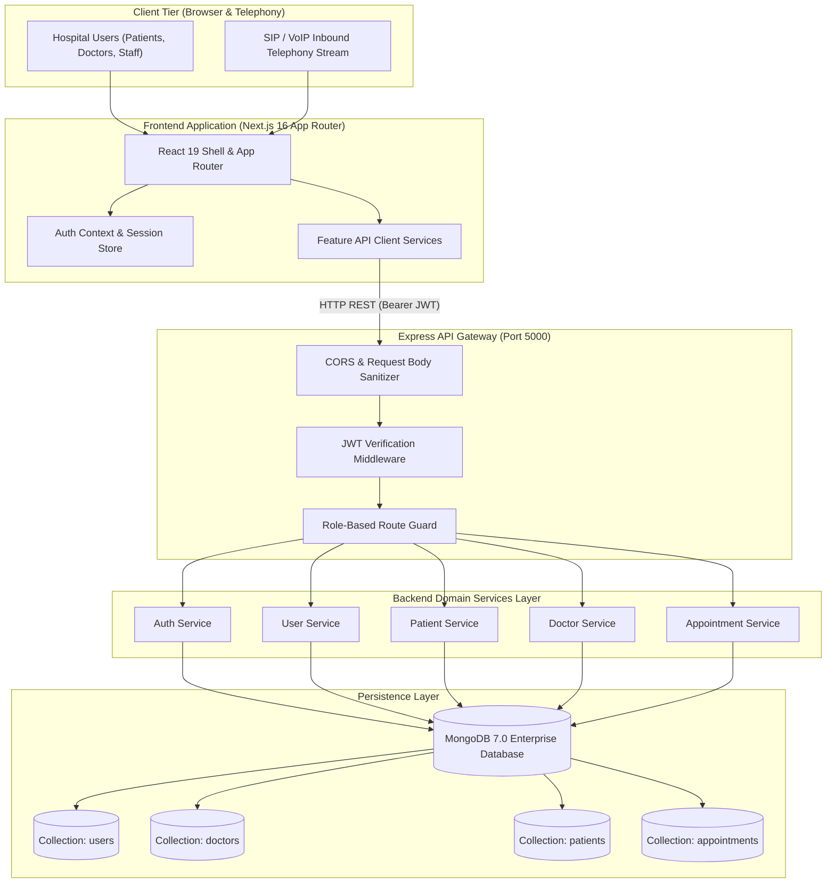
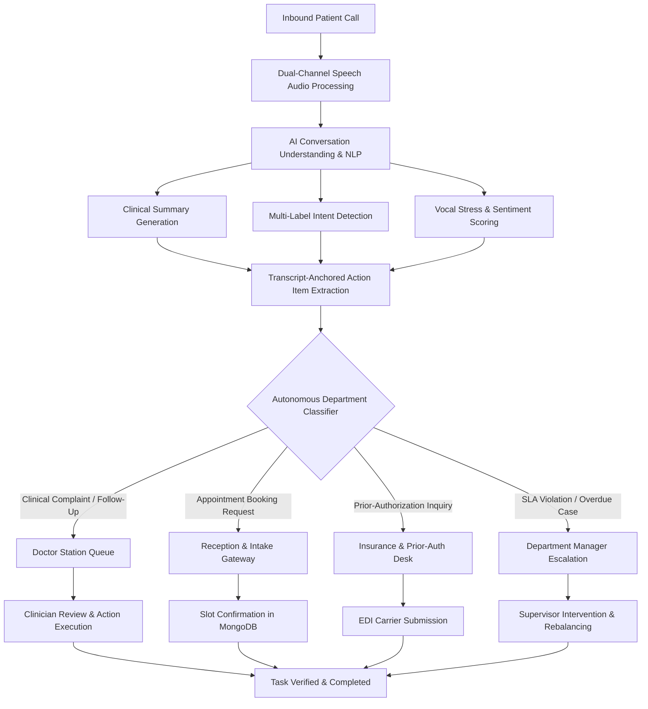
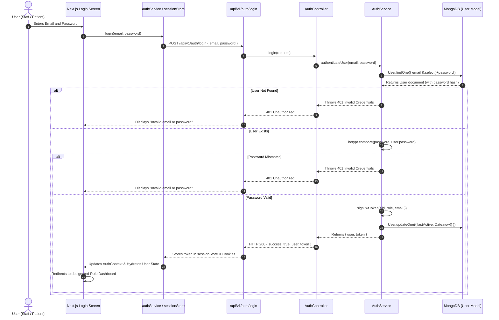
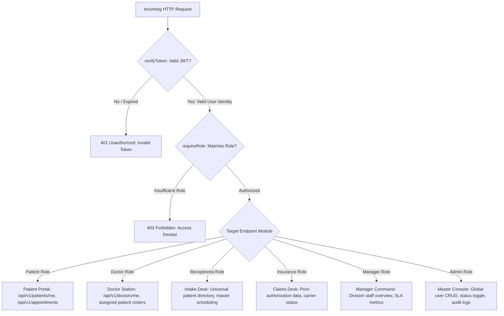
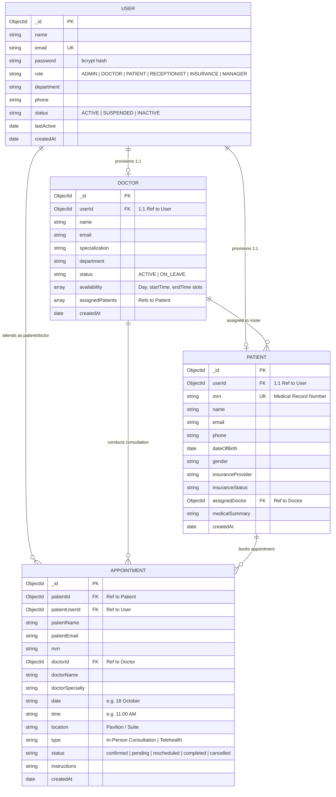
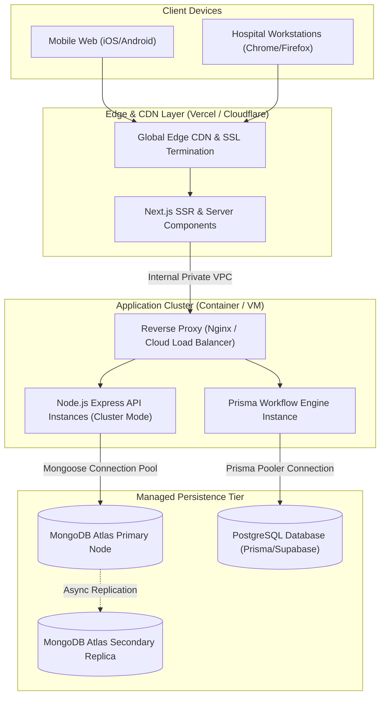
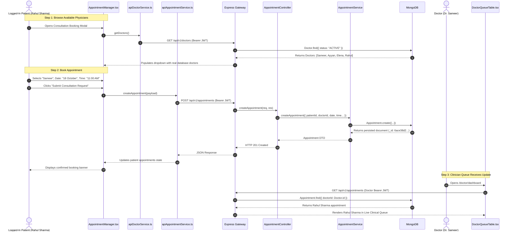

# CareOps AI — Technical Architecture & Visual Documentation

This document provides a comprehensive architectural blueprint of the **CareOps AI** healthcare operations platform. All diagrams use GitHub-native Mermaid syntax to visually articulate system boundaries, communication protocols, database schemas, and request lifecycles.

---

## Table of Contents
1. [High-Level System Architecture](#1-high-level-system-architecture)
2. [Complete Data Flow Diagram](#2-complete-data-flow-diagram)
3. [Authentication & Session Flow](#3-authentication--session-flow)
4. [Role-Based Access Control (RBAC) Flow](#4-role-based-access-control-rbac-flow)
5. [Database Relationship Model (ERD)](#5-database-relationship-model-erd)
6. [Feature Architecture Tree](#6-feature-architecture-tree)
7. [Frontend-to-Backend Layered Flow](#7-frontend-to-backend-layered-flow)
8. [Deployment & Infrastructure Architecture](#8-deployment--infrastructure-architecture)
9. [Complete End-to-End Request Lifecycle](#9-complete-end-to-end-request-lifecycle)
10. [Module Ownership & Implementation Status](#10-module-ownership--implementation-status)

---

## 1. High-Level System Architecture

CareOps AI is structured into decoupled, loosely bound layers: client UI, an API and middleware gateway, encapsulated domain services, and persistence databases.



---

## 2. Complete Data Flow Diagram

This diagram traces how unstructured healthcare phone calls are parsed, transformed into clinical action items, and routed to hospital departments for completion.



---

## 3. Authentication Flow

CareOps AI uses stateless, cryptographically signed JSON Web Tokens (JWT) verified against bcrypt-hashed passwords in MongoDB.



---

## 4. Role-Based Access Control (RBAC) Flow

Every request is intercepted by the server-side RBAC middleware stack (`verifyToken` and `requireRole`). Unauthorized attempts receive immediate `403 Forbidden` errors.



---

## 5. Database Relationship Model (ERD)

The core MongoDB schema is designed around the central `User` identity model, with 1:1 linked role profiles (`Doctor`, `Patient`) and relational references across `Appointment` documents.



---

## 6. Feature Architecture

Visual taxonomy of CareOps AI modules and their respective sub-components:

```mermaid
graph TD
    Root["CareOps AI Platform"]

    Root --> ModAuth["1. Authentication & RBAC Engine"]
    ModAuth --> AuthJWT["JWT Token Generator & Verifier"]
    ModAuth --> AuthBcrypt["Bcrypt Password Hasher"]
    ModAuth --> AuthSession["Next.js SessionStore & Cookies"]
    ModAuth --> AuthGuard["Client RoleGuard & Server Middleware"]

    Root --> ModUser["2. User Management Module"]
    ModUser --> UserCRUD["Staff Onboarding & Directory"]
    ModUser --> UserDept["Departmental Scoping"]
    ModUser --> UserProv["Auto-Provisioning of Doctor/Patient Profiles"]
    ModUser --> UserStatus["Status Lifecycle (Active/Suspended/Inactive)"]

    Root --> ModPatient["3. Patient Management Module"]
    ModPatient --> PatMRN["Deterministic MRN Generator"]
    ModPatient --> PatDirectory["Universal Patient Directory (Staff View)"]
    ModPatient --> PatSelf["Self-Service Personal Health Record"]
    ModPatient --> PatAssigned["Primary Care Physician Assignment"]

    Root --> ModDoctor["4. Doctor Management Module"]
    ModDoctor --> DocRoster["Clinician Directory & Specializations"]
    ModDoctor --> DocSchedule["Weekly Availability Scheduler"]
    ModDoctor --> DocQueue["Assigned Patient Roster & Notes"]

    Root --> ModAppointment["5. Live Appointments Engine"]
    ModAppointment --> AptBook["Real-Time Consultation Booking Modal"]
    ModAppointment --> AptSync["Multi-Role Synchronization (Doctor & Reception)"]
    ModAppointment --> AptLifecycle["Reschedule & Cancellation Handlers"]

    Root --> ModWorkflow["6. Telephony Workflow Engine"]
    ModWorkflow --> WfCalls["Call Event Ingestion (/api/v1/calls)"]
    ModWorkflow --> WfRouting["Intent-to-Department Routing Rules"]
    ModWorkflow --> WfSLA["SLA Countdown Timers & Breach Detection"]
    ModWorkflow --> WfKanban["4-Column Operational Kanban Board"]

    Root --> ModAnalytics["7. Operational Intelligence Suite"]
    ModAnalytics --> AnVolume["Call Volume vs Action Velocity"]
    ModAnalytics --> AnIntent["Multi-Label Intent Distribution"]
    ModAnalytics --> AnWorkload["Departmental Staff Load Capacity"]
```



---

## 7. Frontend-Backend Communication Flow

Every interaction follows a clean multi-tier structure to separate UI concerns from HTTP transport and database queries:

```mermaid
flowchart LR
    subgraph UI_Layer ["React UI Layer"]
        Comp["React Component (AppointmentManager)"]
    end

    subgraph Client_Service ["Client Service Layer"]
        Service["apiAppointmentService.ts"]
        TokenHelper["sessionStore.getClientToken()"]
    end

    subgraph API_Route ["HTTP Transport & Routing"]
        Route["Express Route (/api/v1/appointments)"]
        VerifyMW["verifyToken & requireRole Middleware"]
    end

    subgraph Backend_Controller ["Controller & Logic Layer"]
        Ctrl["appointment.controller.js"]
        Svc["appointment.service.js"]
    end

    subgraph Database_Layer ["Database Layer"]
        Model["Appointment.js (Mongoose Model)"]
        MongoDB[("MongoDB (careops db)")]
    end

    Comp -->|"Calls requestAppointment()"| Service
    Service -.->|"Reads Bearer Token"| TokenHelper
    Service -->|"fetch() HTTP POST"| Route
    Route --> VerifyMW
    VerifyMW --> Ctrl
    Ctrl --> Svc
    Svc --> Model
    Model --> MongoDB
    MongoDB -->> Model
    Model -->> Svc
    Svc -->> Ctrl
    Ctrl -->> Route
    Route -->>|"HTTP 201 JSON"| Service
    Service -->>|"Returns Typed DTO"| Comp
```

---

## 8. Deployment Architecture

This diagram illustrates the production-ready infrastructure deployment model:



---

## 9. Complete End-to-End Request Lifecycle

### Walkthrough: Patient Books Consultation Slot



---

## 10. Module Ownership & Implementation Status

| Module | Architectural Purpose | Database / Tech | Current Status |
|---|---|---|---|
| **Authentication & RBAC** | Secure identity verification, password hashing, and role route guards | Express, JWT, bcryptjs, MongoDB | **Completed (100% Verified)** |
| **User Management** | Administrative staff CRUD, role assignment, and lifecycle toggling | Express, MongoDB `User` model | **Completed (100% Verified)** |
| **Patient Management** | Patient record creation, MRN assignment, and EHR self-service | Express, MongoDB `Patient` model | **Completed (100% Verified)** |
| **Doctor Management** | Physician directory, specialization search, and roster assignments | Express, MongoDB `Doctor` model | **Completed (100% Verified)** |
| **Appointments Engine** | Consultation slot booking, scheduling, and multi-portal sync | Express, MongoDB `Appointment` model | **Completed (100% Verified)** |
| **Workflow Engine** | Relational telephony call event logs, intent routing rules, and SLA tracking | Express, Prisma ORM, PostgreSQL | **Implemented & Tested** |
| **AI Telephony Intelligence** | Audio waveform analysis, diarization scrubbing, and speech NLU | Python FastAPI, Whisper-v3 | **Planned (Q1 2027 Roadmap)** |
| **EHR Interoperability** | Bidirectional sync with hospital EHR systems via HL7 FHIR | SMART on FHIR, HL7 v2 bridges | **Planned (Q2 2027 Roadmap)** |
